# Industrial Storage Unit 3D Models (GLB)

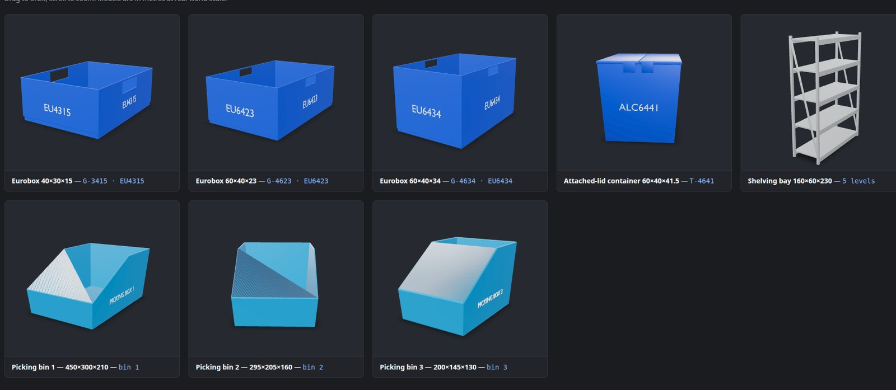

Parametric **GLB** (glTF 2.0 binary) models of the standard industrial storage
units you find in any warehouse, stockroom or workshop: euro stacking containers
on the 600 × 400 mm module, an attached-lid container, open-front picking bins,
and the boltless shelving bay they sit on.

Every model is generated from [`specs/units.json`](specs/units.json) by headless
Blender scripts. There is no hand-modelling anywhere in this repo, so correcting a
dimension is a spec edit and a rebuild rather than a modelling session.

Built for two consumers — a website, and a WMS app doing bin/location
visualisation — which is what drives the design choices: real-world scale, low
triangle counts, flat materials, no textures, and a single self-contained file per
unit.

## Published models

<!-- MODEL-TABLE:START -->

| | Unit | External (mm) | Tris | View |
|---|---|---|---|---|
| <a href="https://sketchfab.com/3d-models/euro-stacking-container-600-x-400-x-230-mm-55b7019a626041e58a7c4128b589004e">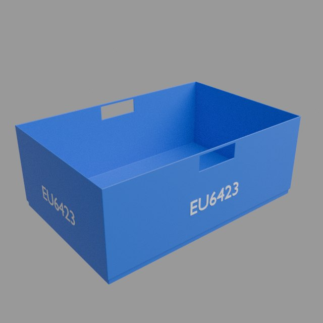</a> | **Euro stacking container**<br>`EU6423` | 600 × 400 × 230 | 2,964 | [View in 3D](https://sketchfab.com/3d-models/euro-stacking-container-600-x-400-x-230-mm-55b7019a626041e58a7c4128b589004e) |
| <a href="https://sketchfab.com/3d-models/euro-stacking-container-400-x-300-x-150-mm-16559b386cac4646aaee842be6d45b7c">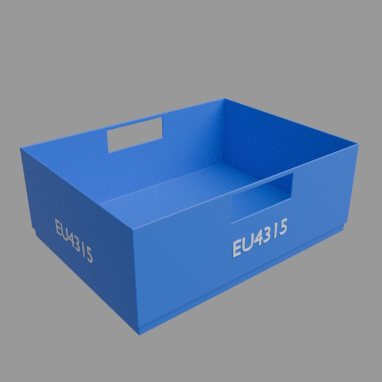</a> | **Euro stacking container**<br>`EU4315` | 400 × 300 × 150 | 2,484 | [View in 3D](https://sketchfab.com/3d-models/euro-stacking-container-400-x-300-x-150-mm-16559b386cac4646aaee842be6d45b7c) |
| <a href="https://sketchfab.com/3d-models/euro-stacking-container-600-x-400-x-340-mm-7799f9273c6148e2ab5957e98dc39ff3">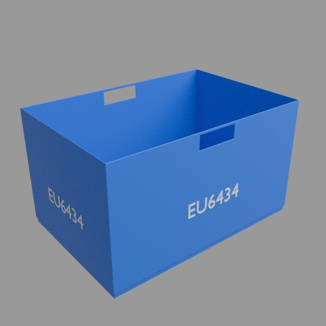</a> | **Euro stacking container**<br>`EU6434` | 600 × 400 × 340 | 2,816 | [View in 3D](https://sketchfab.com/3d-models/euro-stacking-container-600-x-400-x-340-mm-7799f9273c6148e2ab5957e98dc39ff3) |
| <a href="https://sketchfab.com/3d-models/attached-lid-container-600-x-400-x-415-mm-f264471e8639404b8fd2671ff8fea518">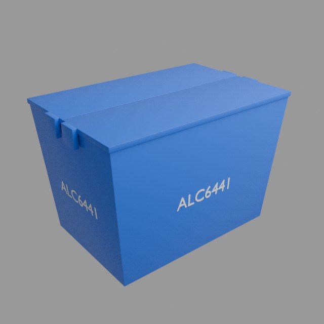</a> | **Attached-lid container**<br>`ALC6441` | 600 × 400 × 415 | 2,548 | [View in 3D](https://sketchfab.com/3d-models/attached-lid-container-600-x-400-x-415-mm-f264471e8639404b8fd2671ff8fea518) |
| <a href="https://sketchfab.com/3d-models/open-front-picking-bin-450-x-300-x-210-mm-a0c5cd8bc3b843c8b47e3e50fb4ab69b">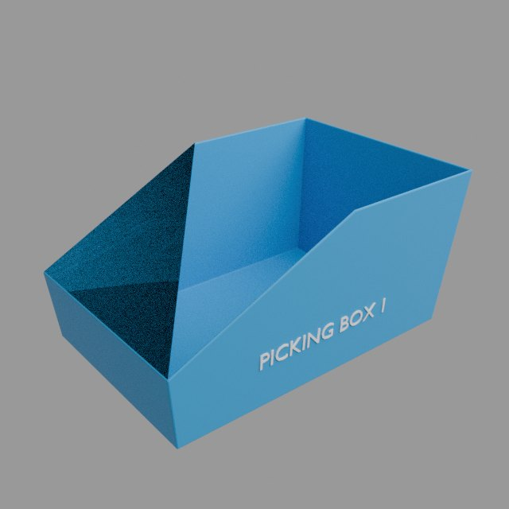</a> | **Open-front picking bin**<br>`PB1` | 450 × 300 × 210 | 2,308 | [View in 3D](https://sketchfab.com/3d-models/open-front-picking-bin-450-x-300-x-210-mm-a0c5cd8bc3b843c8b47e3e50fb4ab69b) |
| <a href="https://sketchfab.com/3d-models/open-front-picking-bin-295-x-205-x-160-mm-5196f2703b9049a1901ab79159eb5965">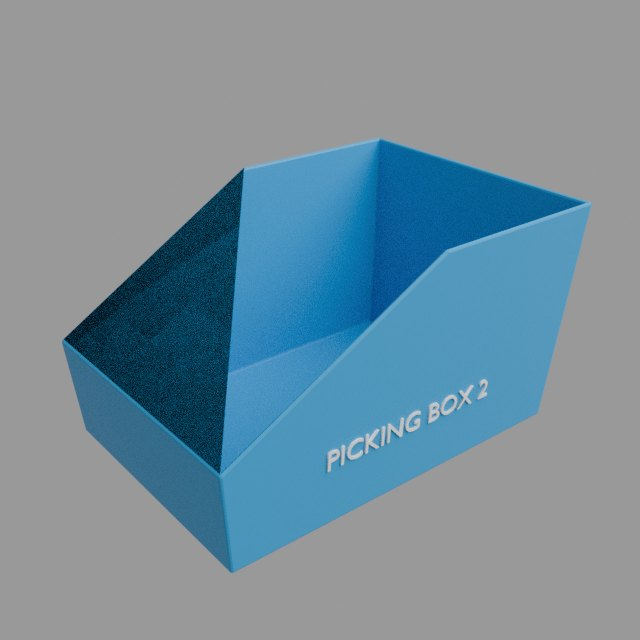</a> | **Open-front picking bin**<br>`PB2` | 295 × 205 × 160 | 2,572 | [View in 3D](https://sketchfab.com/3d-models/open-front-picking-bin-295-x-205-x-160-mm-5196f2703b9049a1901ab79159eb5965) |
| <a href="https://sketchfab.com/3d-models/open-front-picking-bin-200-x-145-x-130-mm-4d78a650b86843f3b21288e10aca14aa">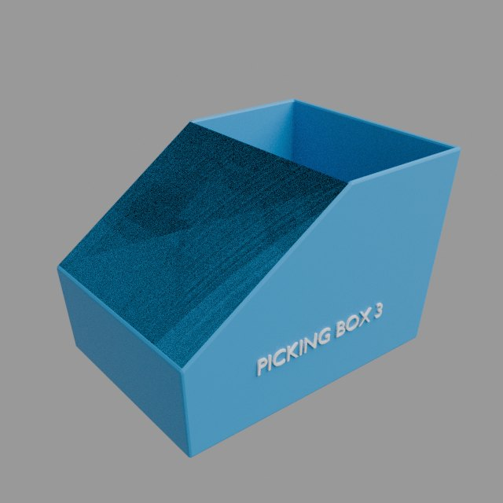</a> | **Open-front picking bin**<br>`PB3` | 200 × 145 × 130 | 2,760 | [View in 3D](https://sketchfab.com/3d-models/open-front-picking-bin-200-x-145-x-130-mm-4d78a650b86843f3b21288e10aca14aa) |
| <a href="https://sketchfab.com/3d-models/boltless-shelving-bay-1600-x-600-x-2300-mm-c4032636399c43f39146660be9a90c4b">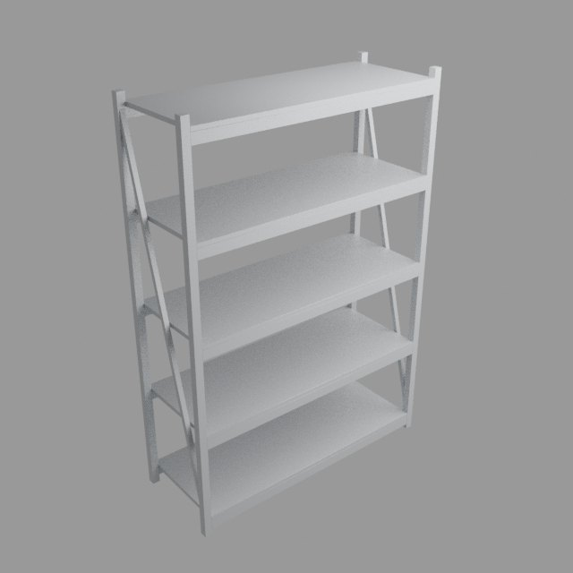</a> | **Shelving bay**<br>`SB1` | 1600 × 600 × 2300 | 924 | [View in 3D](https://sketchfab.com/3d-models/boltless-shelving-bay-1600-x-600-x-2300-mm-c4032636399c43f39146660be9a90c4b) |

All eight are collected at [**Industrial Storage**](https://sketchfab.com/danielrosehill/collections/industrial-storage) on Sketchfab, CC BY 4.0.

<!-- MODEL-TABLE:END -->

## Repository layout

| Path | What it is |
|---|---|
| `models/<CODE>/` | Distribution layout — one folder per unit with the GLB, a preview render, listing copy and the API payload |
| `build/` | Raw generator output, keyed by unit id — generated, not committed |
| `specs/units.json` | The dimensions and materials everything is generated from |
| `specs/descriptions/` | Editorial prose per unit, assembled into the listing copy |
| `scripts/` | Blender generators, plus the staging/upload/table tooling |
| `preview/index.html` | `<model-viewer>` page loading all eight |
| `reference/` | Reference imagery the geometry was measured against |

## The units

### Euro stacking containers

Solid-walled, straight-wall stacking crates on the 600 × 400 mm euro module —
four to a 1200 × 800 mm Euro pallet layer. Open top; lids are a separate item and
are not modelled.

| Code | External L × W × H (mm) | Notes |
|---|---|---|
| `EU4315` | 400 × 300 × 150 | Half module, eight per pallet layer. 150 mm is the commercial rounding of the 147.5 mm VDA 4500 grid height |
| `EU6423` | 600 × 400 × 230 | The common general-purpose size |
| `EU6434` | 600 × 400 × 340 | Deep variant for bulk storage |

### Attached-lid container

| Code | External L × W × H (mm) |
|---|---|
| `ALC6441` | 600 × 400 × 415 |

Same 600 × 400 footprint, but a different moulding in ways that matter:

- **Integral two-part hinged lid** meeting on the centre line, with interlocking
  tabs and front hasp tabs for a security seal.
- **Tapered body** with horizontal rib bands, so these nest when empty with the
  lid open and stack squarely when closed. The taper is why this cannot share the
  straight-wall parametric model.

The lid is modelled closed and fused. If the WMS ever needs to show it open, the
two leaves want separating with a hinge origin on each long edge.

### Open-front picking bins

Polypropylene shelf bins. The front wall stands at roughly 40% of the back wall's
height, with the side walls sweeping down between them on a curve. Tapered body so
empties nest; inset base plinth so loaded bins stack.

| Code | Depth × Width × Height (mm) |
|---|---|
| `PB1` | 450 × 300 × 210 |
| `PB2` | 295 × 205 × 160 |
| `PB3` | 200 × 145 × 130 |

All three are the same moulding in three sizes, so one generator is parametric
over depth/width/height. Note the axis order is **not** the L×W×H used for the
crates above — a trap when transcribing.

### Shelving

| Code | W × D × H (mm) | Levels |
|---|---|---|
| `SB1` | 1600 × 600 × 2300 | 5 *(estimated)* |

Boltless modular steel bay, dimensioned around the euro module: **600 mm depth
matches the container long side exactly**, and 1600 mm width takes four 400 mm
crates per level — twenty per bay across five levels. Shelf pitch is a
representative spacing, not a manufacturer's figure.

## Building

```bash
blender --background --python scripts/build_euroboxes.py    -- --out build
blender --background --python scripts/build_picking_bins.py -- --out build
blender --background --python scripts/build_shelving.py     -- --out build
blender --background --python scripts/build_alc.py          -- --out build

# renders for review; an export can succeed with broken geometry
blender --background --python scripts/render_previews.py    -- --in build --out build/previews
```

For an interactive view, [`preview/index.html`](preview/index.html) loads them all
in `<model-viewer>` — the same renderer the website uses, so it previews the
assets in the target runtime rather than an approximation:

```bash
python3 -m http.server 8731        # then open localhost:8731/preview/
```

## Where these are published

**Sketchfab** — all eight, CC BY 4.0, in the
[Industrial Storage](https://sketchfab.com/danielrosehill/collections/industrial-storage)
collection. See the table above.

**Blog mirror** — the GLBs and their preview renders are also served from the blog:

- **Gallery and downloads:** <https://blog.danielrosehill.com/resources/3d-models> —
  every unit in an in-browser viewer, individual GLB downloads and a zip of the set.
- **Assets:** `https://blog.danielrosehill.com/models/storage-boxes/<id>.glb` (and
  `.jpg` for the preview), served with `Access-Control-Allow-Origin: *` so they can
  be loaded cross-origin.
- **In use:** the [Eurobox logistics calculator](https://github.com/danielrosehill/eurobox-calculator)
  renders these in its "3D models" section and can load a unit's dimensions
  straight into a calculation.

The mirror is a copy, not a submodule. It is refreshed by
`scripts/sync-vendored-tools.sh` in the `Personal-Site-Blog` repo, which pulls from
`build/` and derives its manifest from `specs/units.json` — so **`specs/units.json`
is the dimension source of truth** for everything downstream. Push changes here,
then re-run that script.

Note the two mirrors take different inputs: the blog sync reads `build/` and unit
ids, while Sketchfab is published from `models/` and short codes. Both ultimately
derive from `specs/units.json`.

## Publishing tooling

```bash
python3 scripts/stage_models.py                    # build/ + specs/ -> models/
export SKETCHFAB_API_TOKEN=...
python3 scripts/upload_sketchfab.py --dry-run
python3 scripts/upload_sketchfab.py                # publish + add to collection
python3 scripts/upload_sketchfab.py --refresh      # pull canonical URLs back
python3 scripts/render_model_table.py              # regenerate the table above
```

`models/uploads.json` is the ledger of what is live. It makes the uploader
idempotent — a code already recorded there is skipped rather than published twice —
and it is the input for the table above, so the links are never transcribed by
hand.

Two Sketchfab limits are worth knowing because neither is in their API docs and
both fail the whole upload with an HTTP 400 (verified 2026-07-25): `name` maxes at
**48 characters** and `description` at **1024**. `stage_models.py` enforces the
first and generates a condensed description for the second, so the full
`description.txt` stays long for use elsewhere. Note also that `private` is a paid
feature — on a free account everything published is public as soon as it finishes
processing.

## Design notes

**Labels.** Every unit except the shelving carries raised text from the `label`
field in the spec — `EU6423`, `ALC6441`, `PICKING BOX 1` and so on. They are
geometry rather than a texture, which keeps each asset a single self-contained GLB
with no image payload. The cost is real but manageable: labels take a crate from
676 triangles to ~2,900. Most of that was avoidable — Blender tessellates font
curves at `resolution_u = 12` by default, which alone made the files 350 KB.
Dropping to 3 gives ~130 KB with no visible difference.

The tapered units needed two things the crates did not. Sloping walls mean text
laid out flat and vertical sinks into the wall at one end and floats off it at the
other, so `wall_placements()` returns a rotation that leans each label to match its
wall's draft angle. And the bins' fronts are cut away, so their labels go on the
back and sides.

**What is not modelled.** Deliberately: fine external ribbing on the crates, the
horizontal rib bands on the ALC walls, and on the picking bins the recessed side
grid panels, front label recess, notched rear flange and side mounting hole. All
of it is surface detail that costs geometry and reads as noise at thumbnail and
shelf-view scale.

The crate ribbing was attempted and reverted, which is worth recording so it is
not retried blind. Adding the vertical wall rib columns and the underside waffle
grid as boolean unions works for the walls, but the underside lattice collapses
the mesh to **zero polygons**: Blender's EXACT solver does not survive a
self-intersecting multi-island operand, and a crossing rib grid is exactly that.
Doing it properly needs the lattice pre-resolved into a single manifold solid, or
the ribs cut as insets rather than unioned. Not worth it for detail invisible at
the target scale.

**Colour.** Working values, settled — exact matching is not a requirement, since
real mouldings vary batch to batch and both consumers render these small.

| Family | glTF `baseColorFactor` (linear) |
|---|---|
| Euro containers and ALC | `[0.008, 0.122, 0.738]` |
| Picking bins | `[0.000, 0.319, 0.701]` |

One technical point matters: **glTF `baseColorFactor` is linear, not sRGB.**
Pasting a hex value straight in produces visibly washed-out boxes. Base-colour
*textures* are the opposite — sRGB-encoded, and must not be pre-converted.

Colour sampled from photography is not a reliable method here. Three samples off a
single ALC — `#06549C` shadowed, `#11A4F1` lit, `#34CAFD` on the lid — are the
same piece of blue polypropylene under different lighting, and they span a wider
range than the gap between any two families. An exact reference has to come from a
RAL/Pantone code or a photograph beside a grey card.

**Procedural, not scanned.** Photogrammetry is the wrong tool for these:
dimensions are already known and exact; a scan is a dense irregular mesh plus a
texture atlas at 5–30 MB against a few hundred triangles here; and scans bake
lighting into the texture, so the boxes look wrong under the app's own lighting
and cannot be recoloured. Clean topology also makes it trivial to instance one
mesh hundreds of times in a shelf view.

## Reference imagery

What the geometry was measured against.

| | |
|---|---|
| **400 × 300 × 150**<br>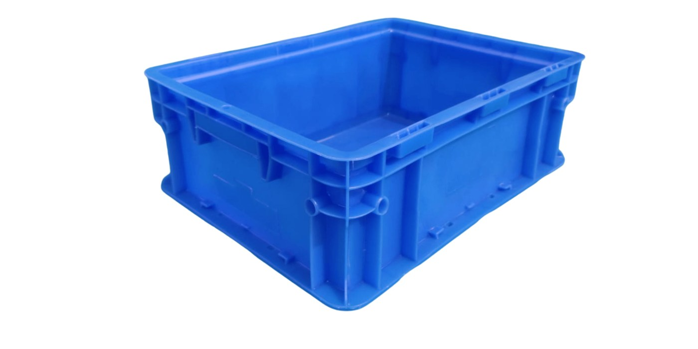 | **600 × 400 × 230**<br> |
| **600 × 400 × 340**<br>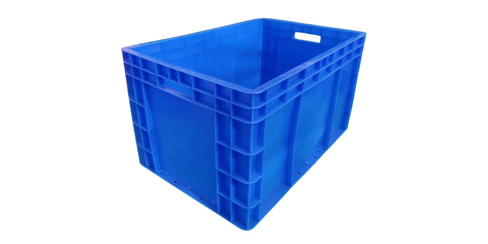 | **ALC 600 × 400 × 415**<br> |

The most useful reference is the front elevation, close enough to orthographic to
measure feature proportions against the known overall dimensions:

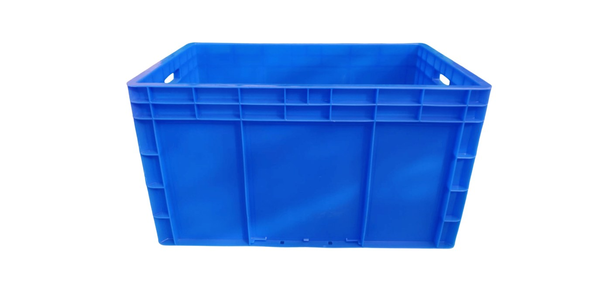

It shows the features shared across the crate family: hand-hole cutouts through
the top rim, a rib grid on the upper wall band, vertical rib columns at the
corners and at intervals, and a smooth recessed centre panel on the lower half —
the natural label location.


The ALC is made in a range of heights on the same 600 × 400 footprint. Since the
generator is parametric over height anyway, the other sizes are nearly free if the
estate grows.


All three picking bins are the same moulding in three sizes, so one reference
serves the whole family.

## Open questions

1. **Do the euro container lids need modelling?** They are a separate item and,
   unlike the ALC's, are not modelled at all.
2. **Does the WMS need a "fill level" representation** — contents visible inside
   an open box? That decision drives whether interiors are modelled properly or
   the boxes stay as closed shells.

## Licence

Models, reference renders and specs: **CC BY 4.0**. Generator scripts: **MIT**.
See [LICENSE](LICENSE).
