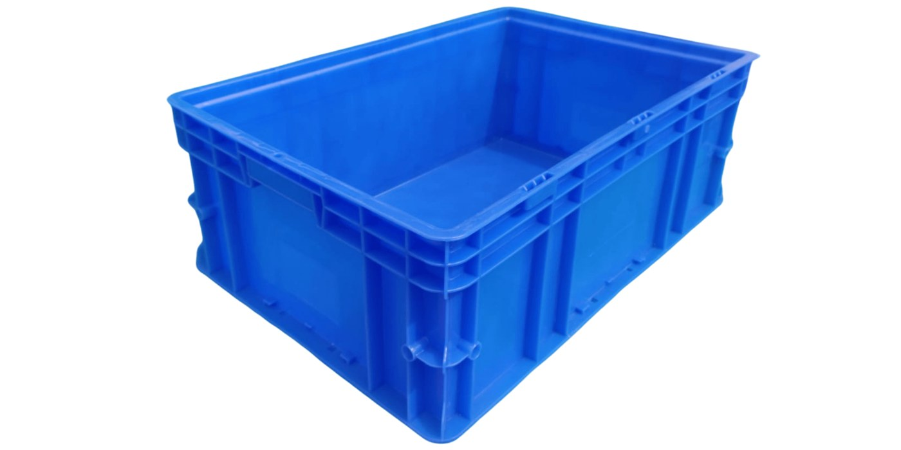
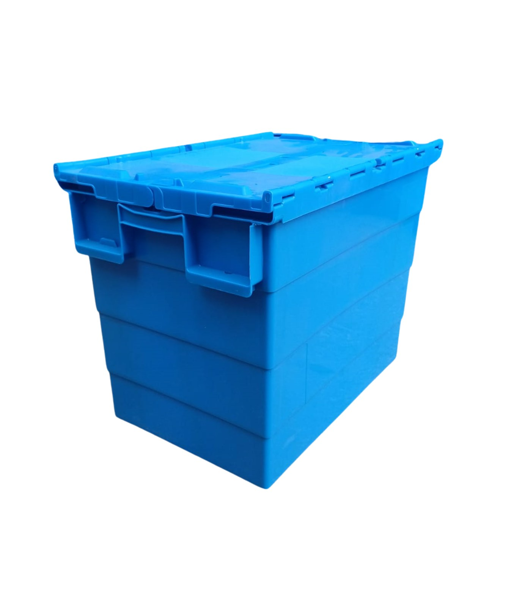
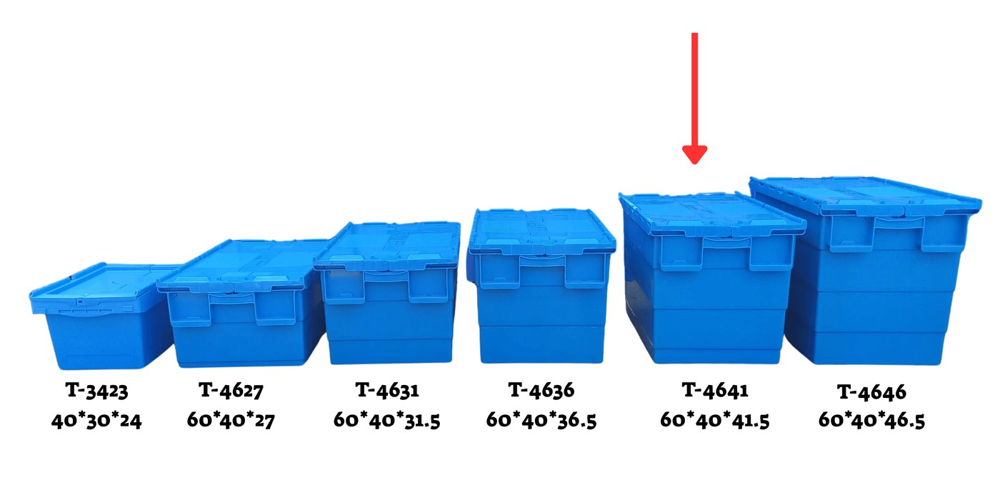
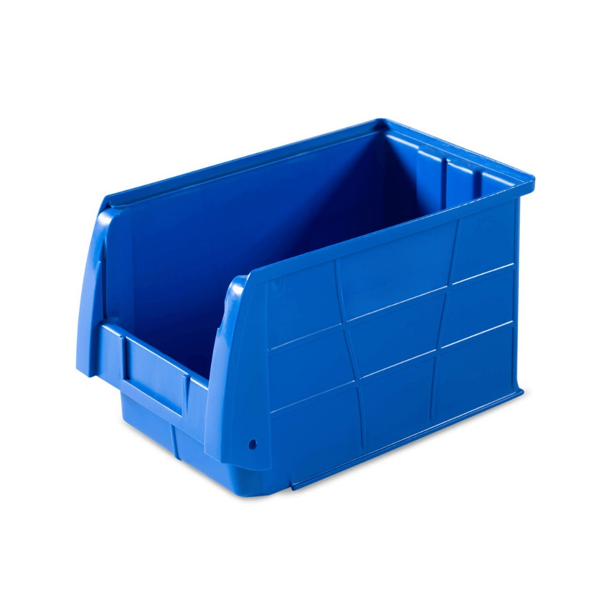

# Industrial Storage Unit 3D Models (GLB)

Planning and reference repo for producing **GLB** (glTF binary) 3D models of the
industrial storage units in use across our inventory estate — euro stacking
containers, an attached-lid container, and open-front picking bins.

The models are destined for two consumers:

- a **website**, and
- the **WMS app** (bin/location visualisation).

Status: **seven of eight units built.** The three euroboxes, three picking bins
and the shelving bay generate as GLBs from `specs/units.json`; the attached-lid
container is still to do. See [Generated models](#generated-models).

## Units to model

### Euro stacking containers

Solid-walled (Hebrew: *אטום*), straight-wall stacking crates on the VDA 4500
600×400 module. Lids are a separate purchase and are **not** part of the base
product.

All three are Yosibox items, all confirmed from their product pages on 2026-07-25.

| Unit | External L×W×H (mm) | Yosibox SKU | Price (inc. VAT) | Product page |
|---|---|---|---|---|
| Eurobox 40×30×15 | 400 × 300 × 150 | `G-3415` | ₪94 | [item 8456001](https://www.yosibox.com/items/8456001-ארגז-תעשייתי-G-3415-40-30-15-) |
| Eurobox 60×40×23 | 600 × 400 × 230 | `G-4623` (מק״ט `G47015`) | ₪112 (₪95 ex.) | [item 8458664](https://www.yosibox.com/items/8458664-ארגז-תעשייתי-G-4623-60-40-23) |
| Eurobox 60×40×34 | 600 × 400 × 340 | `G-4634` | ₪153 | [item 8488075](https://www.yosibox.com/items/8488075-ארגז-תעשייתי-G-4634-60-40-34) |

Two earlier entries are now resolved and dropped: a **40×30×23** (superseded by
the 40×30×15) and a **60×40×31** (Yosibox stock the 340 mm height, not 310).

Both of those "ghost" sizes probably came from the *attached-lid* catalogue
rather than the crate catalogue — the T-family chart below lists a **T-3423 at
40×30×24** and a **T-4631 at 60×40×31.5**, which are near-exact matches. Nothing
to action, but it explains the confusion and is a reason to quote SKUs rather
than dimensions when ordering.

Generic dimensional data for the 600×400×230 and 600×400×310 sizes already
exists in [`eurobox-standard/specs/`](../eurobox-standard/specs/), alongside the
VDA 4500 source document and a parametric OpenSCAD skeleton.

**Yosibox SKU pattern (confirmed across four products).** The code reads as
`<family letter>-<short side dm><long side dm><height cm>`:

| SKU | Decodes as | Actual product |
|---|---|---|
| `G-3415` | 30 × 40, 15 cm | 400 × 300 × 150 |
| `G-4623` | 40 × 60, 23 cm | 600 × 400 × 230 |
| `G-4634` | 40 × 60, 34 cm | 600 × 400 × 340 |
| `T-4641` | 40 × 60, 41 cm | 600 × 400 × 415 |

`G` is the open crate family, `T` the attached-lid family. Note the footprint
digits are **short side first**, so a 600×400 is `46`, not `64`. The height
digits are truncated, not rounded — `41` for a 41.5 cm container — so the SKU
alone is not a safe source of dimensions. Useful for finding products in the
catalogue; not a substitute for reading the product page.

### Attached-lid container (ALC)

| Unit | External L×W×H (mm) | Supplier / SKU | Price | Dimension source |
|---|---|---|---|---|
| ALC 60×40×41.5 | 600 × 400 × **415** | Yosibox — `T-4641`, מק״ט `T04` | ₪155 inc. VAT (₪131 ex.) | [item 8388110](https://www.yosibox.com/items/8388110-ארגז-פלסטיק-תעשייתי-T-4641-60-40-41-5), verified 2026-07-25 |

Confirmed geometry from the product photography, and it differs from the
euroboxes in ways that matter for modelling:

- **Integral two-part hinged lid** (*עם מכסה*) that meets along the centre line,
  with interlocking tabs — not a separate SKU as with the euroboxes.
- **Front hasp tabs** on the lid edge for a security seal.
- **Tapered body** with horizontal rib bands, so the containers **nest** when the
  lid is open and **stack** when it is closed. The taper means this is not a
  scaled-up eurobox and cannot share the straight-wall parametric model.
- Height is **415 mm**, not the 410 mm originally assumed.

### Open-front picking bins

Hebrew *אחסונית / ארקלית*. Polypropylene, stackable and shelf-mountable, sold in
minimum quantities of 10. Note that *ארקלית* is a **trade name, not a material** —
these are opaque PP, not acrylic, so they need no transparency in the model.

| Unit | Depth × Width × Height (mm) | Price | Source |
|---|---|---|---|
| Picking bin 1 | 450 × 300 × 210 | ₪57 | Supplier catalogue page, captured 2026-07-25 |
| Picking bin 2 | 295 × 205 × 160 | ₪36 | Supplier catalogue page, captured 2026-07-25 |
| Picking bin 3 | 200 × 145 × 130 | ₪17 | Supplier catalogue page, captured 2026-07-25 |

Hebrew dimension labels map as: *עומק* = depth (front-to-back), *רוחב* = width
(across the open face), *גובה* = height. The supplier lists them in that order,
which is **not** the L×W×H order used for the euroboxes above — a trap when
transcribing.

Machine-readable versions of all of the above: [`specs/units.json`](specs/units.json).

## Generated models

Seven of the eight units build today. Everything is generated from
`specs/units.json` — no hand-modelling, so a dimension correction is a spec edit
and a rebuild.

```bash
blender --background --python scripts/build_euroboxes.py    -- --out build
blender --background --python scripts/build_picking_bins.py -- --out build
blender --background --python scripts/build_shelving.py     -- --out build

# renders for review; an export can succeed with broken geometry
blender --background --python scripts/render_previews.py    -- --in build --out build/previews
```

| | | |
|---|---|---|
| <br>**40×30×15** · `EU4315` | <br>**60×40×23** · `EU6423` | <br>**60×40×34** · `EU6434` |
| <br>**Picking bin 1** | <br>**Picking bin 2** | <br>**Picking bin 3** |
| <br>**Shelving bay 160×60×230** | | |

For an interactive view, [`preview/index.html`](preview/index.html) loads them all
in `<model-viewer>` — the same renderer the website will use, so it previews the
assets in the target runtime rather than an approximation:

```bash
python3 -m http.server 8731        # then open localhost:8731/preview/
```

### Labels

The euroboxes carry raised text on all four walls, from the `label` field in the
spec: `EU<long side dm><short side dm><height cm>`. Note this runs **long side
first**, the opposite order to the Yosibox SKU — `G-4634` and `EU6434` are the
same crate.

Labels are geometry, not a texture, which keeps each asset a single
self-contained GLB with no image payload. The cost is real but manageable: they
take a crate from 676 triangles to ~2,900. Most of that was avoidable — Blender
tessellates font curves at `resolution_u = 12` by default, which alone made the
files 350 KB. Dropping to 3 gives ~130 KB with no visible difference at the sizes
either consumer renders.

### What is not modelled

Deliberately, per the fidelity target below: fine external ribbing on the crates,
and on the picking bins the recessed side grid panels, front label recess, notched
rear flange and side mounting hole. All are surface detail that costs geometry and
reads as noise at thumbnail and shelf-view scale. The shelf pitch on the bay is an
estimate — the supplier gives the bay size but not the shelf count.

## Reference imagery

One representative image per unit — what the models are being based on. Full
source URLs and the rest of each gallery: [`docs/reference-photos.md`](docs/reference-photos.md).

| | |
|---|---|
| **Eurobox `G-3415`** — 400×300×150<br> | **Eurobox `G-4623`** — 600×400×230<br> |
| **Eurobox `G-4634`** — 600×400×340<br> | **ALC `T-4641`** — 600×400×415<br> |

The single most useful reference is the **`G-4634` front elevation**, which is
close enough to orthographic to measure feature proportions against the known
overall dimensions:


It shows the features shared across the G-family crates: oval **handle cutouts**
through the top rim, a **rib grid** on the upper wall band, **vertical rib
columns** at the corners and intervals, and a smooth **recessed centre panel** on
the lower half — the natural label location.

The ALC gallery also contains a **T-family size chart**, which is where the
sibling sizes below come from:



| SKU | Size (cm) |
|---|---|
| `T-3423` | 40×30×24 |
| `T-4627` | 60×40×27 |
| `T-4631` | 60×40×31.5 |
| `T-4636` | 60×40×36.5 |
| **`T-4641`** | **60×40×41.5** ← the one in scope |
| `T-4646` | 60×40×46.5 |

Since the ALC generator has to be parametric over height anyway, the other five
sizes are nearly free once `T-4641` is built — worth knowing if the estate grows.

### Picking bins



All three bins are the same moulding in three sizes, so one reference serves the
whole family — the generator is parametric over depth/width/height. Features to
carry into the model:

- **Open front.** The front wall stands at roughly 40% of the back wall's height;
  the side walls sweep down between the two on a curve, not a straight chamfer.
- **Recessed grid panel** on both side walls — two rows by three columns of
  shallow recessed rectangles, framed by raised ribs.
- **Recessed label area** on the front face, below the opening.
- **Inset base plinth**, narrower than the body, so a bin stacks into the one
  below rather than sitting flat on it.
- **Rear top flange** with notches, for stacking registration or rail hanging.
- **Small circular mounting hole** low on the side wall.

The bins still have **no recorded supplier or product URL** — the dimensions and
prices came from catalogue screenshots that were not retained, so unlike the four
Yosibox items these rows can't be independently re-verified. See open question 2.

## Colour

All units are blue. Beyond that, **the supplier photography cannot tell us how
blue**, and this is worth stating clearly because it is easy to be fooled by it.

Sampled values, all from supplier product photos on 2026-07-25:

| Family | Sampled sRGB range |
|---|---|
| Euro stacking containers | `#0E4CCC` – `#1662DF` |
| ALC | `#06549C` (shadowed face) – `#11A4F1` (lit face) – `#34CAFD` (lid top) |
| Picking bins | `#0099DA` – `#039AE1` |

The ALC row is the tell. Those three samples are **the same piece of blue
polypropylene** under different lighting, and they span a wider range than the
gap between any two families in the table. So the apparent differences between
families are within the noise floor of the method, and my earlier read that the
euroboxes and picking bins are two distinctly different blues was overstated —
the photos do not support that conclusion either way.

The same applies to the ALC lid, which looks like a brighter cyan than its body
in every photo. That is exactly what an upward-facing surface does under overhead
studio lighting, so it is most likely one colour, not a two-tone moulding.

Practical consequences:

1. **Do not author materials from these hex values.** Get the RAL or Pantone
   reference from Yosibox and the bin supplier, or photograph a real unit beside
   a grey card. Until then, model with a single shared blue and treat per-family
   colour as an open question.
2. **glTF `baseColorFactor` is linear, not sRGB.** Whatever value is settled on,
   pasting the hex straight in produces visibly washed-out boxes; convert first
   (`c ≤ 0.04045 ? c/12.92 : ((c+0.055)/1.055)^2.4`). Base-colour *textures*, by
   contrast, are sRGB-encoded and must not be pre-converted — only the factor is.

## Approach

**Recommendation: model these procedurally, not by scanning.** Polycam is the
wrong tool here, for reasons specific to these two consumers:

- **Dimensions are already known and exact.** Photogrammetry would recover them
  approximately, at best, and needs manual scale-setting afterwards.
- **File size.** A box like this is a few hundred triangles with a single flat
  material — a GLB in the low kilobytes. A Polycam scan is a dense irregular
  mesh plus a texture atlas, realistically 5–30 MB. On a website that difference
  is the whole page budget; in a WMS view showing many bins at once it is fatal.
- **Baked lighting.** Scans bake shadows and highlights into the texture, so the
  boxes look wrong under the app's own lighting and cannot be recoloured — and,
  per the colour section above, the baked-in lighting is severe enough to make
  the plastic look like three different blues.
- **Clean topology** makes it trivial to swap colour per bin type, or to
  instance one mesh hundreds of times in a shelf view.

Scanning only becomes worth it if the site wants photoreal hero imagery with
real-world wear and labels — a different requirement from what's described here.

**Toolchain.** Blender 5.0.1 is installed on this machine and exports GLB
natively, so a headless Python script (`blender --background --python`) can
generate every unit from the numbers in `specs/units.json` in one pass. OpenSCAD
is *not* installed, and the `eurobox-standard` SCAD skeleton exports STL — a
format with **no colour or material support at all**, so an OpenSCAD → STL → GLB
path would still need materials reapplied downstream. That makes Blender the
shorter route despite the existing SCAD work, which remains useful as a
dimensional cross-check.

**Three geometry families, not one generator.** The straight-wall euroboxes
share a parametric model driven by L/W/H. The ALC needs its own (taper, hinged
lid, hasp tabs). The picking bins need a third (open front, tapered nesting
body, front lip). Budget the work accordingly.

**Fidelity target.** Correct external dimensions, wall thickness, rounded rim
and corner radii, and the stacking lip/foot — but not the fine external ribbing
visible in the product photos. At the on-screen sizes both consumers will use,
ribs cost geometry and read as noise. Revisit if the website wants close-ups.

## Related repos

- [`eurobox-standard`](../eurobox-standard/) — VDA 4500 source PDF, summary,
  dimension specs, parametric OpenSCAD skeleton.
- [`Yosi-Box-Catalogue`](../Yosi-Box-Catalogue/) / [`yosibox-catalogue`](../yosibox-catalogue/) — Yosibox supplier catalogue; source for the eurobox and ALC SKUs.
- [`Israel-Parts-Bins-Research`](../Israel-Parts-Bins-Research/) — picking bin sourcing.
- [`Wheres-My-Stuff-Deployment`](../Wheres-My-Stuff-Deployment/) — the WMS.

## Open questions

1. **Actual colour references** from both suppliers — see the colour section.
2. **Picking bin supplier** — the three bins have confirmed dimensions and
   prices but no recorded supplier or product URL, unlike the four Yosibox
   items. Worth capturing so the data can be re-verified later.
3. **Do the eurobox lids need modelling?** They are a separate SKU. The ALC's is
   integral, and if the WMS ever shows open vs closed it wants to be a separate
   mesh with a hinge origin — two hinge origins, in the ALC's case.
4. **Where do the built GLBs live** — committed here, or published to R2/MinIO
   for the website and WMS to fetch?
5. **Does the WMS need a "fill level" representation** (contents visible inside
   an open box)? That decision drives whether interiors are modelled properly or
   the boxes stay as closed shells.

## Next step

Write the Blender generator for the straight-wall eurobox family first, driven by
`specs/units.json`, using the Yosibox 60×40×23 as the reference build. The ALC
and picking bin generators follow as separate pieces of work.
